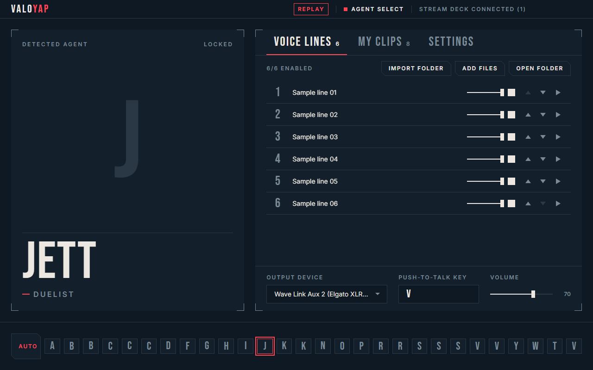

# ValoYap

A Windows app that notices which Valorant agent you are playing and switches your Elgato Stream Deck to that agent's soundboard. Press a key and the clip plays through an output device (by default an Elgato Wave Link virtual channel) into your in-game mic, optionally holding your push-to-talk key for you.



> Screenshots use placeholder agents and invented clip names. No Riot artwork or audio is stored in this repository.

## What is in the box

| Part | Path | What it does |
| --- | --- | --- |
| Desktop app | `apps/desktop` | Electron + React UI, detection, audio playback, push-to-talk, localhost bridge |
| Stream Deck plugin | `apps/streamdeck` | `com.carsonjf.valoyap.sdPlugin`: switches profile, fills keys, sends `play` |
| Core logic | `packages/core` | Log parser, state machine, Riot local API client, clip library, playback controller |
| Shared types | `packages/shared` | Config schema (zod), protocol, key table, clip resolution, theme |

See [docs/ARCHITECTURE.md](docs/ARCHITECTURE.md) for the design and [docs/PTT_SPIKE.md](docs/PTT_SPIKE.md) for the push-to-talk test.

## Safety: read-only by design

ValoYap never touches the game process.

- No memory reads, no injection, no overlays, no hooks.
- It tails `%LocalAppData%\VALORANT\Saved\Logs\ShooterGame.log` to learn that the game moved between menu, agent select and a match.
- On those transitions only, it makes **GET** requests to the local Riot Client and the game's own services, using your own session, to read **your own** current character. The one network primitive in the code can only issue GET, and a unit test fails the build if `detection/` ever contains a POST/PUT/PATCH/DELETE or a bare `fetch(`.
- It never locks, selects or changes anything in the game, and never sends requests about other players.
- The Stream Deck bridge listens on `127.0.0.1` only and refuses any connection that carries a browser `Origin` header.
- Push-to-talk is a normal keyboard (or mouse) input, the same as pressing the key yourself. See the caveats in [docs/PTT_SPIKE.md](docs/PTT_SPIKE.md).

This is an unofficial tool. Riot does not publish this detection route, so it could break after a game update. The manual agent picker always works.

## Riot assets are not included

Agent portraits and icons are downloaded at runtime from the community API `valorant-api.com` into `%AppData%\ValoYap\cache` (git-ignored). **Voice lines are not shipped or downloaded**: the public API exposes no voice-line audio and the in-game audio is packed in Wwise archives. Bring your own files: drop `.wav/.mp3/.ogg/.flac/.m4a/.aac/.opus/.webm` files into `%AppData%\ValoYap\voicelines\<Agent>\` (or press **Import folder**), and your own clips into `%AppData%\ValoYap\clips\<Agent>\`. A folder named `shared` applies to every agent. A file watcher picks changes up live.

## Requirements

- Windows 10/11, Node.js 22+, pnpm 12 (`npm i -g pnpm`)
- For the plugin: Elgato Stream Deck software 6.9+
- Optional: Elgato Wave Link for routing audio into your mic

## Build and run

```powershell
pnpm install
pnpm build
pnpm test
pnpm start            # launches the desktop app against the live game log
pnpm dev              # launches with a replayed fixture log (no game needed)
pnpm screens          # regenerates docs/screens from the mock UI
```

If Electron's binary did not download during `pnpm install` (pnpm blocks install scripts by default and some Node versions fail on its installer), run once:

```powershell
$env:NODE_OPTIONS="--experimental-require-module"; node node_modules\.pnpm\electron@*\node_modules\electron\install.js
```

### Stream Deck plugin

```powershell
pnpm --filter @valoyap/streamdeck build
# Install by linking (needs the Elgato CLI: npm i -g @elgato/cli):
cd apps\streamdeck
streamdeck link com.carsonjf.valoyap.sdPlugin
```

Or copy the folder `apps\streamdeck\com.carsonjf.valoyap.sdPlugin` to `%AppData%\Elgato\StreamDeck\Plugins\` and restart the Stream Deck software. The plugin ships one generic **ValoYap Soundboard** profile per device size (Stream Deck, Mini, XL, +, Neo). On any key layout the last three keys are Previous page / Next page / Back and every other key is a Clip key; ValoYap fills them with the current agent's clips and pages through longer lists. Back returns to your previous profile. The plugin looks for the desktop app on `127.0.0.1:38120` (the default; change it in Settings and rebuild/edit `DEFAULT_PORT` if you move it).

## Routing audio into your mic (Wave Link)

1. In Wave Link, create or pick a channel for ValoYap (for example **Soundboard**, or **Aux 2**), and make sure it is routed to your **Stream Mix** or whichever mix feeds your mic.
2. In ValoYap, open the **Output device** dropdown (bottom right) and choose the matching Wave Link virtual device (for example `Wave Link Soundboard` or `Wave Link Aux 2 (Elgato …)`). ValoYap preselects a Wave Link soundboard/aux device when it finds one and never defaults to a physical output.
3. In Valorant: set **Input Device** to the Wave Link virtual microphone (**Wave Link Stream** / **Wave Link MicrophoneFX**, whichever carries your chosen mix), set the voice chat mode to **Push to Talk**, and bind the same key in ValoYap's **Push-to-talk key** picker.
4. Test with **Settings → Test hold (2s)**, then a short clip in a custom game.

If Valorant ignores the key press ValoYap sends, set **Who presses the key** to **External** and have the Stream Deck (hotkey / multi-action) hold the PTT key instead. That is the documented fallback.

## Using it

- **Status line** (top right): `MENU`, `AGENT SELECT` or `IN MATCH`, with a red marker only while you are in agent select or a match.
- **Agent strip** (bottom): pick any agent manually; the red outline is the active agent; `AUTO` returns to detection.
- **Voice lines / My clips**: numbers are the Stream Deck key numbers. Rename (double-click), reorder (arrows), enable or disable, set a per-clip volume. The playing row fills red and shows progress.
- **Settings**: per-clip cooldown (default 4 s), volume cap (default 80 %, the final gain can never exceed it), include shared clips, PTT mode, pre-roll and tail, input method, Stream Deck status.
- There is deliberately no ranked/competitive toggle; choose what to play and when.

Config lives in `%AppData%\ValoYap\config.json` (versioned; a corrupt file is backed up as `config.json.corrupt-<timestamp>` and replaced by defaults).

## What is verified and what is not

Verified in this repo: unit tests for the log parser, state machine, replay, config schema, clip library, layout and key rendering, plus a localhost bridge test; the app builds and, in replay mode, detects an agent, serves slots to a bridge client and plays a clip through the full push-to-talk timeline.

Needs a real machine to confirm: live detection against a running Valorant session, the Stream Deck plugin and bundled profiles inside the Stream Deck software, Wave Link routing, and whether Valorant accepts the synthetic PTT key. See [docs/PTT_SPIKE.md](docs/PTT_SPIKE.md).

## Licence

MIT, see [LICENSE](LICENSE). Bundled fonts (Bebas Neue, Inter) are under the SIL Open Font License, see [THIRD_PARTY_NOTICES.md](THIRD_PARTY_NOTICES.md). ValoYap is not affiliated with Riot Games or Elgato. VALORANT is a trademark of Riot Games, Inc.
